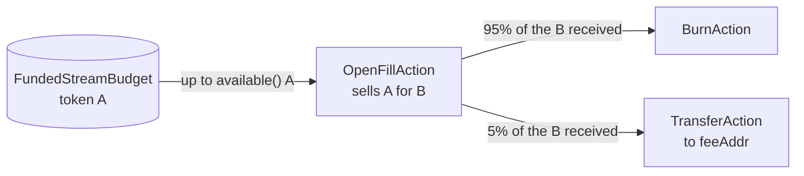
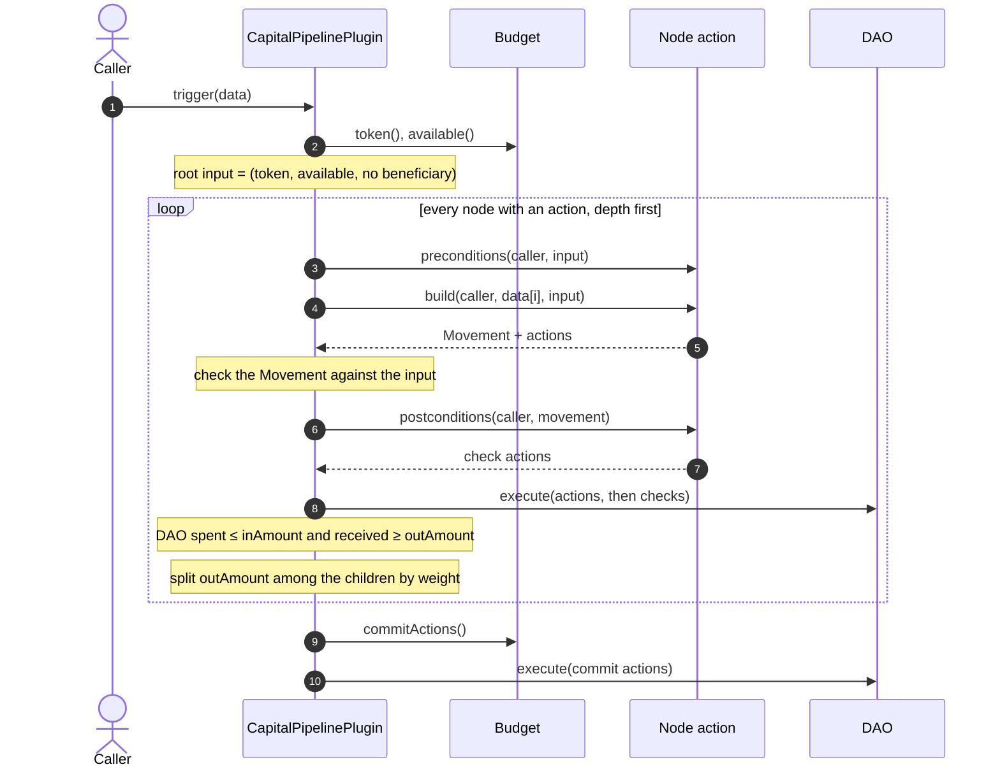
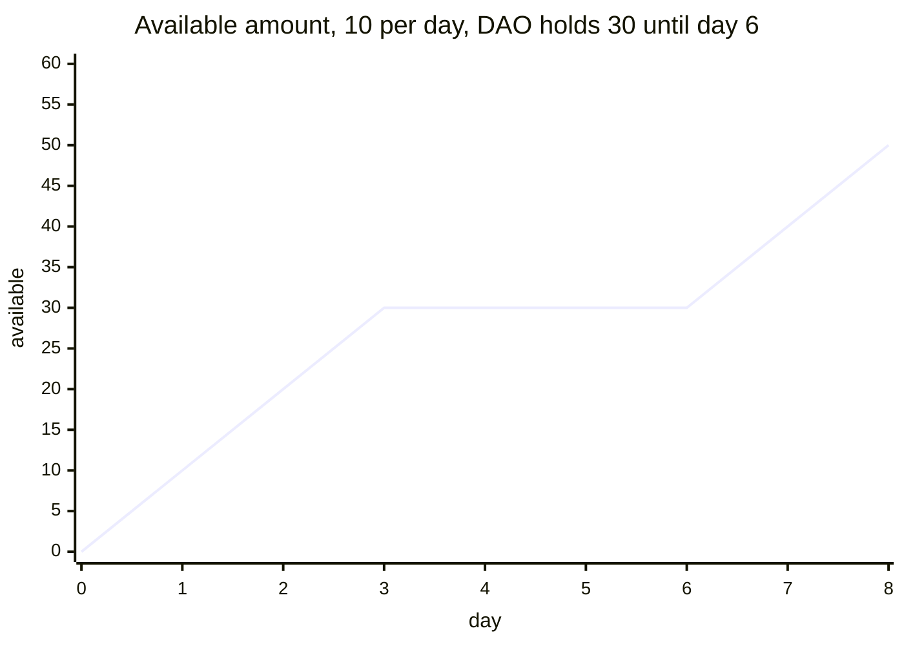
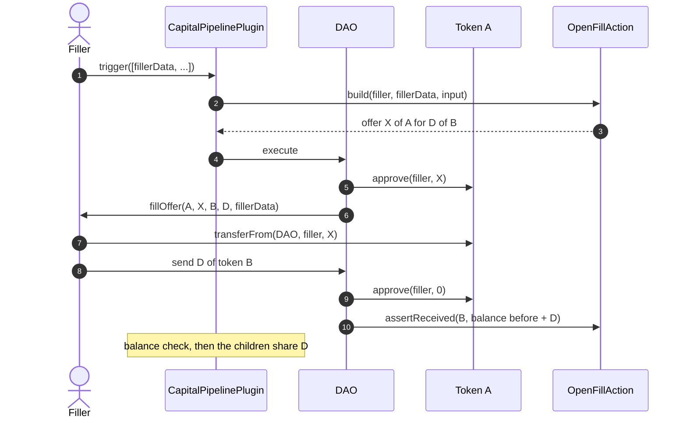
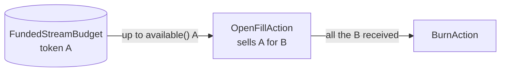
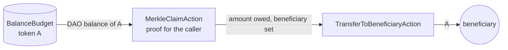
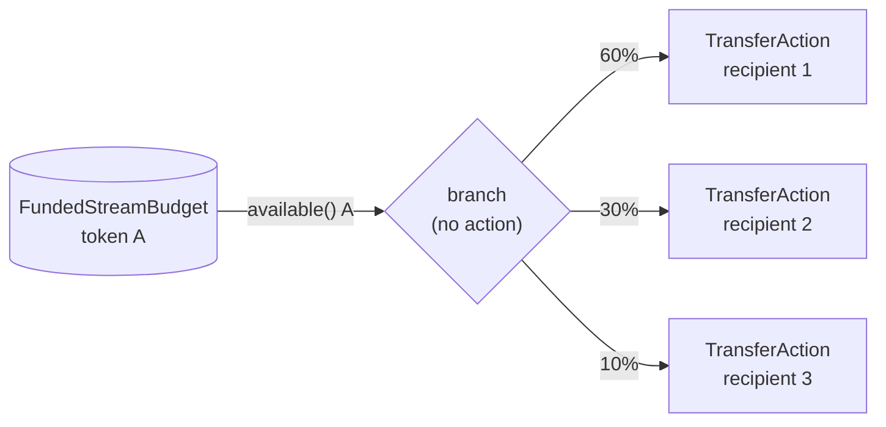
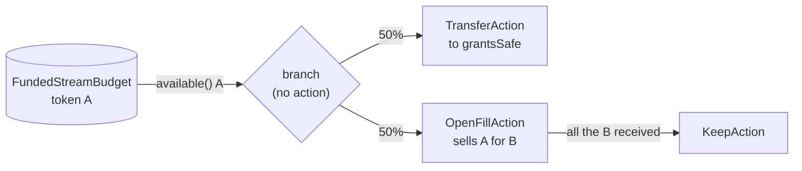
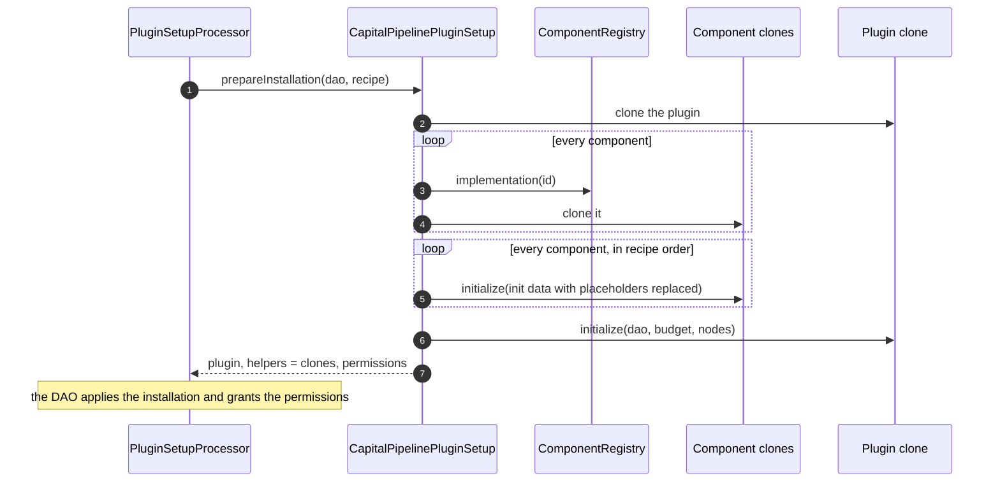
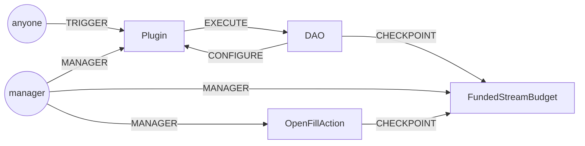

# Capital Pipeline

Aragon OSx plugin that runs one treasury flow per install: a **budget** feeding a **tree of
actions**. Every node passes its output to its children, split by fixed weights when there are
several, and every branch ends in a leaf that consumes what it receives (transfer, burn, keep).
Each node runs in its own `dao.execute`, followed by balance checks, so a node can only ever spend
what the budget released or what its parent really produced.



Examples: sell token A in a Dutch auction and burn 95% of the proceeds, paying 5% as a fee; let
accounts claim cumulative Merkle allocations, optionally swapped before they're paid; pay a
payroll from a stream. Any ERC20 works, and native ETH as `0xEeeeeEeeeEeEeeEeEeEeeEEEeeeeEeeeeeeeEEeE`.

Design: [`docs/plans/2026-11-04-capital-pipeline-design.md`](docs/plans/2026-11-04-capital-pipeline-design.md)

## How it works

| Term | Meaning |
|---|---|
| **Budget** | How much of one token the flow may spend right now. Read once at the start of a trigger, committed once at the end. |
| **Node** | One step of the tree: an action, its children, and the weights that split its output among them. Node 0 is the root and receives the budget. |
| **Action** | A contract that plans what a node does. It never moves funds itself: it returns DAO actions, which the plugin executes through the DAO. |
| **Branch** | A node without an action and with 2+ children. It splits its input among them unchanged. |
| **Leaf** | A node without children. Its action consumes its whole input and outputs nothing. |

Amounts move down the tree as two structs:

```solidity
struct Input    { IERC20 token; uint256 amount; address beneficiary; }        // what a node receives
struct Movement { IERC20 inToken; uint256 inAmount;                           // what it spends
                  IERC20 outToken; uint256 outAmount; address beneficiary; }  // what its children get
```

### One trigger, step by step

`trigger(bytes[] data)` takes either no data or one entry per node; each action receives its own
entry and the caller's address.



Any failure reverts the whole trigger: a flow never runs halfway. When a node has several
children, the rounding remainder of the split goes to the child with the largest weight.

### What the plugin enforces

When a node runs:

1. A node fed by the budget (the root, or one below branches without an action) takes more than zero and at most its input; every other node takes exactly its input. What a node fed by the budget doesn't take never left the DAO.
2. A node spends the token it received; a leaf outputs nothing; any output is native ETH or a contract.
3. Once an action sets a beneficiary, it can't change further down the tree.
4. Actions can't target the DAO or the plugin.
5. After the node's `dao.execute`, the DAO spent at most `inAmount` and holds at least `outAmount` more.

When the flow is set (`initialize` or `setFlow`, DAO only):

1. 1 to 16 nodes; every child comes after its parent, has exactly one parent, and is reachable from node 0.
2. A node without an action has at least 2 children.
3. Weights appear only on nodes with 2+ children: one per child, none zero, summing to 1,000,000.
4. An action bound to a budget (OpenFill, MerkleClaim) must be fed by that same budget: the root, or a node below branches without an action.
5. The budget and every action are clones bound to this plugin's DAO.

## Components

### Budgets

A budget implements `IBudget`: `token()`, `available()` and `commitActions()`, the DAO actions
that record the spend after the whole tree ran.

| Budget | `available()` | Commit |
|---|---|---|
| `FundedStreamBudget` | Grows by `amountPerEpoch` every `epochInterval`, capped as described below | Restarts from zero |
| `BalanceBudget` | The DAO's whole balance of the token | Nothing |

#### FundedStreamBudget

A stream that never jumps, built for Dutch auctions where a jump in the offer would be taken by
a filler in the same block.

```
available = min(baseAmount + rate × (now − baseTimestamp), lastSeenBalance, daoBalance, maxBudget)
```

The amount is capped at `lastSeenBalance`, the DAO balance seen at the last checkpoint or
`sync()`, and a deposit doesn't move that until someone syncs. While the DAO is short, the amount
stops growing instead of building up a backlog, and after a deposit and a `sync()` it resumes from
where it stopped.

The chart streams 10 per day from a DAO holding 30, with a deposit of 100 and a `sync()` on day 6.
The amount stops at 30 while the DAO is short and resumes from 30 after the sync.



| Call | Who | Effect |
|---|---|---|
| `sync()` | anyone | Carries the current amount forward and records the DAO balance. Never raises the amount. |
| `writeCheckpoint()` | `CHECKPOINT_PERMISSION_ID` | Restarts from zero. The plugin runs it through the DAO after every trigger. |
| `setAmountPerEpoch`, `setMaxBudget`, `setEpochInterval` | `MANAGER_PERMISSION_ID` | Sync first, so time already elapsed keeps the old values. |

After a deposit the amount stays frozen until someone calls `sync()`: run a keeper, or add a
`sync()` action wherever revenue enters the DAO.

#### BalanceBudget

The DAO's whole balance of a token, with nothing to commit. Use it when something else decides
the amount, such as a Merkle claim; the budget only caps it at what the DAO holds.

### Actions

Every action implements `INodeAction`, and the plugin calls all of its hooks on every node, so an
action's safety checks can't be skipped.

| Hook | Returns |
|---|---|
| `budget()` | The budget the action is bound to, or `address(0)` if it works with any input |
| `preconditions(caller, input)` | Nothing; reverts when the action must not run |
| `build(caller, data, input)` | The `Movement` and the DAO actions that do the work |
| `postconditions(caller, movement)` | DAO actions that check the work, run right after it |

#### OpenFillAction (root, or below branches without an action)

A take-it-or-leave-it swap priced as a Dutch auction. The bound stream grows the offer of token A
from zero, and the DAO demands a flat `demandPerFill` of token B for it. The price obtained,
`demandPerFill / offered`, worsens as the offer grows, until `maxOffered()` caps the offer at
`demandPerFill / minDemandedPerOffered`. Whoever finds the trade worth it first calls `trigger()`
and fills it.

- **Moves**: offers `min(input, maxOffered())` of A, outputs `demandPerFill` of B to its children.
- **Placement**: the root, or below branches without an action, where its input is its share of
  the budget (see "Grants and an auction" below). Every node of the flow then waits for a fill, and
  changing the price terms restarts the whole budget, not just the auction's share.
- **Checks**: the DAO received at least `demandPerFill` of B, or the whole trigger reverts.
- **Settings**: `setDemandPerFill`, `setMinDemandedPerOffered` (`MANAGER_PERMISSION_ID`). Both restart
  the auction, so the action needs `CHECKPOINT_PERMISSION_ID` on its budget.
- **Native ETH** works on either side, never both: a native offer arrives as call value with the
  callback, without approvals.



The filler implements `IFiller.fillOffer`, which has the same selector as capital-router's
`ISwapSolver.fillOffer`, so existing fillers keep working.

#### MerkleClaimAction (root)

Cumulative Merkle distribution. Each leaf is `(account, cumulative amount)`, in OpenZeppelin's
StandardMerkleTree format, and an account can claim `cumulative − claimed` at any time. A new root
raises the cumulative amounts for the next round.

- **Data**: `abi.encode(account, cumulative, proof, beneficiary)`. Only the account itself can claim;
  `beneficiary == 0` pays the account.
- **Moves**: takes what the account is owed and outputs it unchanged, setting the flow's
  beneficiary so a `TransferToBeneficiaryAction` further down pays it.
- **Records** the claim with `recordClaim`, executed by the DAO inside the claim's node, so it rolls
  back with the flow. The DAO needs `RECORD_CLAIM_PERMISSION_ID` on the action.
- **Settings**: `setRoot` (`MANAGER_PERMISSION_ID`). Whoever holds it can direct payouts up to the
  DAO's balance of the token.
- **Root only**: reverts with `NotTheWholeBudget` unless its input is the whole budget. Below a
  branch, its siblings would take a share of the whole budget on every claim.

One claim per trigger.

#### Leaves

Leaves extend `LeafAction`: they spend their whole input and output nothing.

| Leaf | Does | Check |
|---|---|---|
| `TransferAction` | Sends the input to a fixed recipient | The recipient's balance rose by the amount |
| `TransferToBeneficiaryAction` | Sends the input to the flow's beneficiary; reverts if none was set | Same as above |
| `BurnAction` | Calls `burn(amount)` on an `ERC20Burnable` token; rejects native ETH | The plugin's balance check |
| `KeepAction` | Nothing: the input stays in the DAO, so keeping funds is an explicit choice | — |

The transfer check catches tokens that return `false` instead of reverting. Fee-on-transfer and
rebasing tokens fail it by design.

## Example flows

`script/Recipes.sol` builds four flows. The buyback is the diagram at the top. The other three:

**Buy and burn**: the buyback without a fee, burning everything the swap brings in.



**Merkle claim**: an account claims what it's owed and gets paid, possibly at another address.



**Payroll**: a stream split among fixed recipients by a branch with no action.



**Grants and an auction** (no recipe): a branch with no action splits a stream between a grants
transfer and an auction, so the auction's offer grows at half the stream's rate. Grants are paid
only when someone fills the auction. If the offer reaches `maxOffered()`, the rest of the auction's
share stays in the DAO, and the stream restarts from zero for both.



## Installation

A recipe lists the components to clone (by registry id), the budget, the tree and the extra
permissions. It names contracts that don't exist yet with placeholders: `DAO_REF`, `PLUGIN_REF`
and `ref(i)` for the recipe's component `i`. The setup replaces them wherever they appear.



Every component is a fresh clone bound to the installing DAO; the plugin rejects any other.
Initialize order matters: list a component after the ones its initializer checks (OpenFill reads
its budget's token, so the budget comes first).

Preparing is permissionless and installs nothing. The DAO installs the flow by executing three
actions in one proposal, which `script/Install.s.sol` prints:

1. Grant `ROOT_PERMISSION_ID` on the DAO to the PluginSetupProcessor.
2. `PluginSetupProcessor.applyInstallation(dao, ...)`, which grants the recipe's permissions.
3. Revoke that `ROOT_PERMISSION_ID`.

Only the DAO itself can apply the installation.

## Permissions

| Permission | Holder | Allows |
|---|---|---|
| `TRIGGER_PERMISSION_ID` | anyone | `trigger()` |
| `CONFIGURE_PERMISSION_ID` | DAO only | `setFlow()` |
| `MANAGER_PERMISSION_ID` | manager | parameter setters, Merkle `setRoot()`, `pause()`, `unpause()` |
| `CHECKPOINT_PERMISSION_ID` | DAO, swap action | restarting the stream budget |
| `RECORD_CLAIM_PERMISSION_ID` | DAO | Merkle `recordClaim()`, run by the plugin through the DAO |
| `REGISTER_PERMISSION_ID` | picked by the managing DAO | registering new components |

The setup always grants `EXECUTE` and `CONFIGURE`; a recipe lists the rest, and its grants may
only target the plugin or the recipe's components. The buyback and buy-and-burn recipes grant
these (an arrow goes from the holder to the contract it may call):



## Layout

| Path | What |
|---|---|
| `src/CapitalPipelinePlugin.sol` | Runs the tree, checks balances after every node |
| `src/budgets/FundedStreamBudget.sol` | Streaming pot that never jumps |
| `src/budgets/BalanceBudget.sol` | The DAO's whole balance of a token |
| `src/actions/OpenFillAction.sol` | Open-fill swap with Dutch-auction pricing (root, or below branches without an action) |
| `src/actions/MerkleClaimAction.sol` | Cumulative Merkle claims with a redirectable beneficiary (root only) |
| `src/actions/base/LeafAction.sol` | Base for leaves: spends the whole input, outputs nothing |
| `src/actions/base/TransferBase.sol` | Base for transfer leaves: one transfer plus a receipt check |
| `src/actions/TransferAction.sol` | Leaf: sends its input to a fixed recipient |
| `src/actions/TransferToBeneficiaryAction.sol` | Leaf: sends its input to the flow's beneficiary |
| `src/actions/BurnAction.sol` | Leaf: burns its input |
| `src/actions/KeepAction.sol` | Leaf: leaves its input in the DAO |
| `src/registry/ComponentRegistry.sol` | Write-once ids for the implementations recipes can clone |
| `src/setup/CapitalPipelinePluginSetup.sol` | Installs any flow from a recipe |
| `script/Recipes.sol` | Recipes for buy and burn, buyback, Merkle claim and payroll |
| `script/Deploy.s.sol` | Deploys every implementation, the registry and the setup, and publishes the setup to an Aragon plugin repo |
| `script/Install.s.sol` | Prepares an installation from a config and prints the proposal's actions |
| `installs/` | One example config per recipe |
| `metadata/release.json`, `metadata/build.json` | The plugin repo's release and build metadata |
| `metadata/components/` | One JSON per component: name, description, `initialize` inputs |
| `metadata/uris.json` | The IPFS link of each metadata file, read by the deploy script |

## Develop

```shell
git submodule update --init --recursive
forge build
forge test
```

Never set `via_ir = true`; fix stack-too-deep errors by restructuring the code.

`lib/ens-contracts` is only there so Aragon's framework contracts compile. The installation test
deploys Aragon's plugin repo registry, factory and PluginSetupProcessor locally, without ENS.

## Deploy

Once per network:

1. Upload `metadata/release.json`, `metadata/build.json` and every file in `metadata/components/`
   to IPFS (any pinning service).
2. Put each `ipfs://...` link in `metadata/uris.json`: `release`, `build`, and each component's
   name under `components`. The script refuses to run while a link is empty, because registry
   entries and plugin repo versions can't be changed later.
3. Run:

```shell
MANAGING_DAO=0x... PLUGIN_REPO_FACTORY=0x... \
  forge script script/Deploy.s.sol --rpc-url <rpc> --broadcast
```

| Variable | Meaning |
|---|---|
| `MANAGING_DAO` | Maintains the component registry |
| `PLUGIN_REPO_FACTORY` | Aragon's `PluginRepoFactory` on that network |
| `PLUGIN_REPO_SUBDOMAIN` | Optional: the name under `plugin.dao.eth`, `capital-pipeline` by default |
| `PLUGIN_REPO_MAINTAINER` | Optional: who can publish later versions, the managing DAO by default |

## Install a flow

1. Copy an example from `installs/` (`buy-and-burn`, `buyback`, `merkle-claim`, `payroll`) and fill
   in the DAO, the manager, the tokens and the amounts (in the token's smallest unit).
2. Run:

```shell
INSTALL_CONFIG=installs/<yours>.json PLUGIN_SETUP_PROCESSOR=0x... PLUGIN_REPO=0x... \
  forge script script/Install.s.sol --rpc-url <rpc> --broadcast
```

3. Put the three printed actions in a DAO proposal. Once it executes, the flow is live: fillers can
   call `trigger()` and the manager can tune it.
